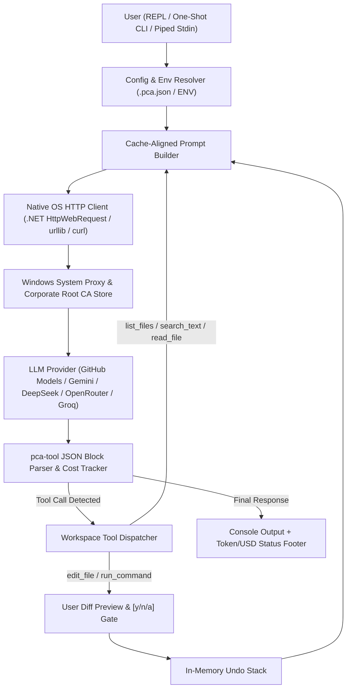

# Architecture & Agentic Tool Protocol

This document explains the internal design of `pca` ([`pca.ps1`](../pca.ps1) and [`pca.sh`](../pca.sh)) and how it achieves full agentic coding capabilities with **zero external libraries** and **minimal token consumption**.

---

## 1. High-Level Architecture



---

## 2. Why Universal `pca-tool` Blocks Instead of Vendor-Specific Function Calling?

Many free-tier models on OpenRouter, GitHub Models, or local Ollama servers either reject complex OpenAI `tools` JSON schemas or hallucinate malformed tool call arguments.

Instead, `pca` teaches the LLM a compact, model-agnostic fenced block protocol (`pca-tool`):
````markdown
```pca-tool
{"tool": "read_file", "path": "src/App.cs", "start_line": 1, "end_line": 80}
```
````

### Benefits of This Design
1. **Works on 100% of LLMs**: Any text-generating model (from a 7B local model to `gpt-4o`, `gemini-2.5-flash`, or `DeepSeek-R1`) can emit a 1-line JSON block inside triple backticks.
2. **Saves ~600 Input Tokens per Turn**: We don't have to send verbose JSON-Schema definitions in the `tools` parameter on every single API request.
3. **Transparent to the User**: You can see the exact tool call the model is making right in your terminal output.

---

## 3. Built-In Agentic Tools

| Tool Name | JSON Payload Format | Token & Safety Guardrails |
| :--- | :--- | :--- |
| **`list_files`** | `{"tool": "list_files", "sub_dir": ".", "max_depth": 2}` | Automatically skips `.git`, `node_modules`, `bin`, `obj`, `dist`, `build`, `.venv`, and caps output at 150 entries. |
| **`search_text`** | `{"tool": "search_text", "pattern": "regex", "sub_dir": "."}` | Skips binary/large files (`>1 MB`), truncates long matching lines at 160 chars, and caps at 40 matches. |
| **`read_file`** | `{"tool": "read_file", "path": "file.ps1", "start_line": 1, "end_line": 120}` | Enforces `max_read_lines` (default 200 lines per call) and prefixes 1-indexed line numbers. |
| **`edit_file`** | `{"tool": "edit_file", "path": "file.ps1", "search": "old", "replace": "new"}` | Verifies exact uniqueness of `search` block, preserves `CRLF`/`LF` line endings, shows +/- diff preview, prompts for confirmation, and saves original content to `UndoStack`. |
| **`run_command`** | `{"tool": "run_command", "command": "dotnet test"}` | Always prompts for user confirmation (unless `-AutoApprove` is set), enforces a 30-second timeout, and truncates combined stdout/stderr at 3,500 chars. |

---

## 4. Token & Cost Optimization Mechanics

### A. Prompt Cache Alignment
Cloud providers like **DeepSeek**, **OpenAI**, and **Google Gemini** cache the static prefix of your `messages` array:
- Message `0` (`role: system`) contains the deterministic `pca` instructions followed by any pinned files (`/add`).
- Because this prefix never mutates from turn to turn, follow-up turns in a coding session automatically achieve **75%–90% cache hit rates** on the system context.

### B. Output Token Minimization via `SEARCH / REPLACE`
LLM output tokens are **3x to 4x more expensive** than input tokens (and much slower to generate).
- Rewriting a 500-line file wastes ~4,000 output tokens.
- Sending an `edit_file` `search`/`replace` block for a 5-line bug fix uses only ~80 output tokens — a **98% reduction in output cost and latency**.

### C. Automatic Sliding-Window Compaction
After `KeepRecentTurns` (default 10 messages), `Compact-HistoryIfNeeded` scans older turns (such as raw file reads or search outputs from 5 turns ago) and truncates messages longer than 600 characters while keeping the most recent 4 messages intact in full detail.
